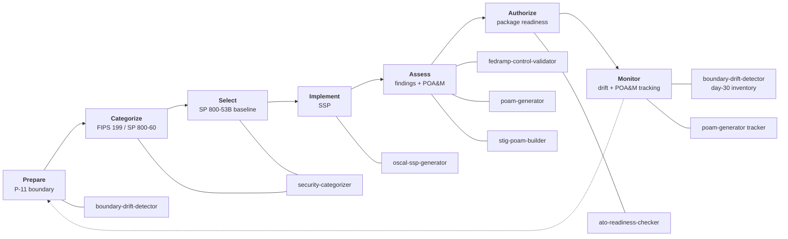

# rmf-toolchain

One synthetic system, taken through every step of the NIST Risk Management Framework
(SP 800-37 Rev 2) by seven separate open-source tools that pass OSCAL 1.1.2 between them.
GitHub Actions runs the whole chain on every push, validates every OSCAL document against
NIST's official schemas, and publishes the resulting package as a build artifact.

> Every input is synthetic. The readiness result in step 7 is a tool's measure of the
> package, not an authorization decision. Only the Authorizing Official makes that decision.

## The problem

Each RMF step usually lives in its own tool, spreadsheet or person. The handoffs are where
things break: the SSP's categorization doesn't match the categorization memo, the POA&M
lists a different system ID than the SSP, the assessment covers 22 controls while the
baseline has 340, and nobody sees it until the package lands on the AO's desk. This repo
runs the handoffs as code, so every push shows whether the pieces still fit together.

## RMF step → repo



| RMF step | Run by this pipeline | Related repos (not in the pipeline) |
|---|---|---|
| Prepare | [boundary-drift-detector](https://github.com/JulietRodriguez/boundary-drift-detector) (task P-11: is the declared boundary what's actually deployed?) | |
| Categorize | [security-categorizer](https://github.com/JulietRodriguez/security-categorizer) | |
| Select | [security-categorizer](https://github.com/JulietRodriguez/security-categorizer) (SP 800-53B baseline as an OSCAL profile) | [cmmc-control-mapper](https://github.com/JulietRodriguez/cmmc-control-mapper) for CMMC |
| Implement | [oscal-ssp-generator](https://github.com/JulietRodriguez/oscal-ssp-generator) (SSP from Terraform state) | [cloud-governance-platform](https://github.com/JulietRodriguez/cloud-governance-platform) |
| Assess | [fedramp-control-validator](https://github.com/JulietRodriguez/fedramp-control-validator) (Assessment Results from AWS Config), [poam-generator](https://github.com/JulietRodriguez/poam-generator) and [stig-poam-builder](https://github.com/JulietRodriguez/stig-poam-builder) (POA&Ms) | [cmmc-scorecard](https://github.com/JulietRodriguez/cmmc-scorecard) for CMMC |
| Authorize | [ato-readiness-checker](https://github.com/JulietRodriguez/ato-readiness-checker) | |
| Monitor | boundary-drift-detector on a day-30 inventory, poam-generator's SQLite tracker | [continuous-monitoring-dashboard](https://github.com/JulietRodriguez/continuous-monitoring-dashboard) (runs on its own simulated data, so it isn't chained here) |

## Quick start

Python 3.11 or newer (stig-poam-builder needs 3.11).

```bash
git clone https://github.com/JulietRodriguez/rmf-toolchain && cd rmf-toolchain
python -m venv .venv && source .venv/bin/activate
pip install -r requirements-tools.txt     # the seven tools, each pinned to a release tag
pip install -e ".[dev]"
rmf-toolchain run --out out
```

`out/README.md` is the run summary; each step's files are in `out/<step>/`, with the exact
command and the tool's full output in `out/<step>/log.txt`. Add `--schema-dir <dir>` to
validate every OSCAL document against NIST's schemas (CI uses a fresh download; the
committed copies in `schemas/` work too). Exit code 0 means every step ran and every OSCAL
document is valid; 1 means a step failed or a document is invalid.

To get the package without installing anything, open the latest
[CI run](https://github.com/JulietRodriguez/rmf-toolchain/actions/workflows/ci.yml) and
download the `rmf-package` artifact.

## Sample input and output

Input: [`inputs/`](inputs/README.md), one synthetic system, "SYNTHETIC Case Management
System (CMS-DEMO)": a categorization worksheet, a Terraform state, AWS Config inventories
(day 0 and day 30), AWS Config rule evaluations, POA&M findings, and three STIG checklists
plus an ACAS (Nessus) scan.

Output from the run on 2026-11-17 (the default `--as-of` date, so the run is repeatable):

| # | RMF step | Tool | Result |
|---|---|---|---|
| 1 | Categorize | security-categorizer v0.1.0 | Moderate system: C=moderate, I=moderate, A=low; 3 information types |
| 2 | Select | security-categorizer v0.1.0 | SP 800-53B Moderate + Privacy: 340 controls (OSCAL profile) |
| 3 | Implement | oscal-ssp-generator v0.1.0 | Draft SSP: 20 controls with implementation statements, 13 inventory items |
| 4 | Prepare (boundary, P-11) | boundary-drift-detector v0.1.0 | 12/12 declared resources found; 1 undeclared S3 bucket (high, CM-8); 1 unverified encryption expectation |
| 5 | Assess | fedramp-control-validator v0.1.0 | 22 controls assessed, 11 not satisfied; score 70.5% |
| 6 | Assess → POA&M | poam-generator v0.6.0, stig-poam-builder v0.1.0 | 5 POA&M items from assessment findings, 15 from STIG checklists and ACAS |
| 7 | Authorize | ato-readiness-checker v0.1.0 | NEEDS WORK (score 80.9): 0 critical, 325 high package issues; 7 open Critical/High weaknesses for the AO |
| 8 | Monitor | boundary-drift-detector, poam-generator | Day 30: 1 undeclared instance (high), 1 missing instance (medium); POA&M loaded into the tracker |

OSCAL validation: 12 of 12 documents valid against NIST's OSCAL 1.1.2 schemas.

### What the chain catches

Step 7 is where the handoffs get checked. On this sample it reports, among others:

- **320 baseline controls not addressed in the SSP** (CTRL-001, high). The SSP generator
  writes statements only for what the infrastructure shows (20 controls); the selected
  Moderate + Privacy baseline has 340. That gap is real and expected for an
  infrastructure-generated draft, and it's why the result is NEEDS WORK, not READY.
- **5 not-satisfied assessment findings with no POA&M item** (TRC-001, high), and **8
  POA&M items with no matching finding** (TRC-002, medium). The STIG POA&M and the AWS
  Config assessment describe different evidence, and the checker shows exactly where they
  don't meet.
- **10 controls the SSP calls implemented that the assessment found not satisfied** (CTRL-004).
- **7 open Critical/High weaknesses** reported separately for the AO (RISK-001: 2 critical, 5 high),
  including SSH open to the internet on the application security group. These don't lower
  the score; they're risk for the AO to weigh, not package defects.

## How the pieces connect

The tools were built separately, so two things don't line up out of the box. The pipeline
fixes both in [`stitch.py`](src/rmf_toolchain/stitch.py) and records each change in the
document's metadata remarks:

1. **Categorization into the SSP.** oscal-ssp-generator can't know the system's
   categorization from Terraform, so it writes a placeholder. The pipeline copies
   security-categorizer's information types, impact levels and sensitivity level into the
   SSP, and points the SSP's `import-profile` at the selected baseline profile.
2. **One system ID.** The POA&M tools don't know the SSP's system ID. The pipeline sets
   each POA&M's `system-id` to the SSP's, so the readiness check sees one system.

Everything else is the tools' own output, produced by their own command lines.

## Design choices

- **Run the real CLIs, not library calls.** Each step runs the tool the way a user would,
  so the pipeline tests the same interface the README of each tool documents. The logs
  show the exact commands.
- **Pin every tool to a release tag.** `requirements-tools.txt` installs each tool from a
  tag, with the commit listed beside it. Tests check every tool is pinned; CI checks each
  tag still points at its listed commit, so a moved tag fails the build.
- **Validate every OSCAL file, every push.** CI downloads NIST's OSCAL 1.1.2 schemas,
  checks their SHA-256 against `schemas/SHA256SUMS`, and validates every JSON document the
  run produced. Any invalid document fails the build.
- **A fixed `--as-of` date.** POA&M due dates and overdue checks depend on "today". A
  fixed date keeps the output identical from run to run.
- **Keep the edits small and visible.** The pipeline changes only what's needed to join
  the documents, and says so inside them.

More detail, in plain language: [docs/design-notes.md](docs/design-notes.md).

## Limits

- **Synthetic, single system.** One AWS system, one account, one region. The inputs are
  made to exercise each tool, not to represent a real environment.
- **Not every step is automated end to end.** Control implementation statements beyond
  what the infrastructure shows, assessor judgment, and the authorization decision itself
  are human work. The pipeline shows how far automation gets and where people take over.
- **The stitching is specific to these tools.** Another SSP generator or POA&M tool would
  need its own glue.
- **Monitor is a snapshot, not a schedule.** Step 8 compares one later inventory and loads
  the POA&M tracker; it doesn't run continuously. continuous-monitoring-dashboard isn't
  chained because it works from its own simulated data.
- **CMMC is out of scope here.** cmmc-control-mapper and cmmc-scorecard follow a different
  framework and aren't part of this RMF chain.
- **Federal mode only.** security-categorizer's NSS mode needs CNSSI 1253 data the user
  supplies, so this sample uses SP 800-60 federal categorization.

## Development

```bash
pip install -e ".[dev]"
ruff check . && ruff format --check .
pytest --cov=rmf_toolchain                 # the full-pipeline test runs when the tools are installed
python tools/make_inputs.py --check        # inputs/ matches the generator
```

## License

Apache-2.0. See [LICENSE](LICENSE) and [NOTICE](NOTICE).
